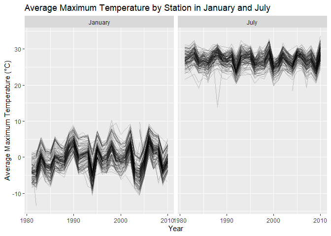
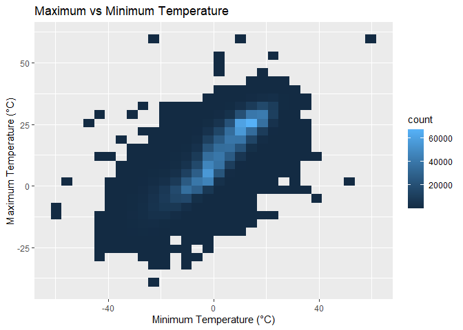
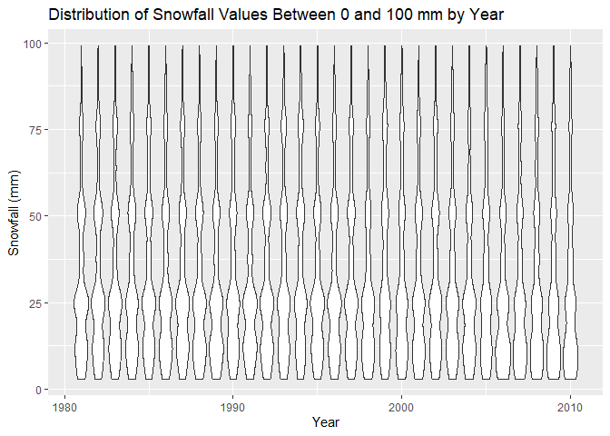
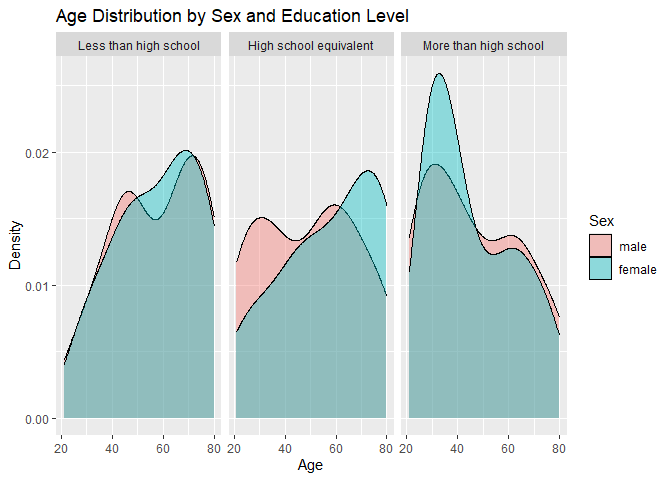
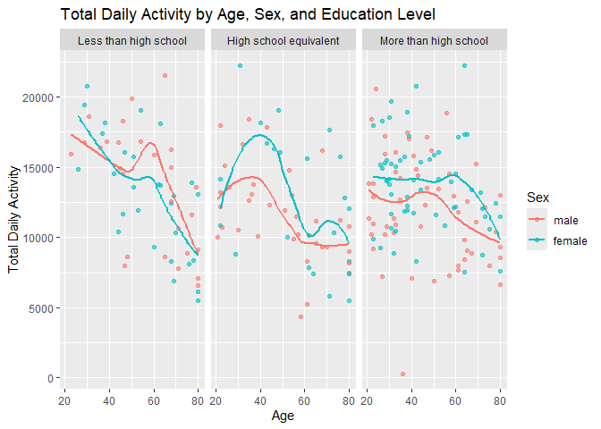
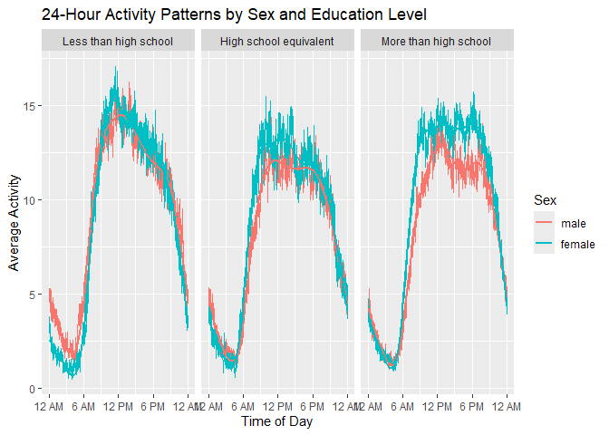
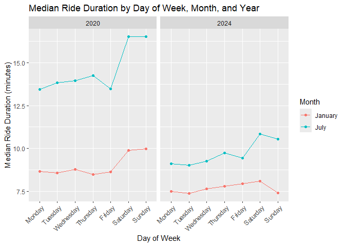
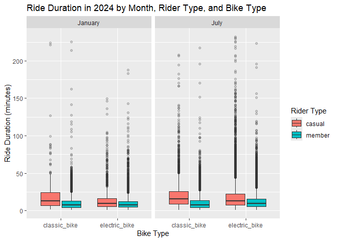

Homework 3
================
Jiaqi Xie
2026-10-19

## Problem 1

``` r
data("ny_noaa")
```

``` r
ny_noaa |>
  summarize(
    across(
      everything(),
      ~ mean(is.na(.))
    )
  )
```

    ## # A tibble: 1 × 7
    ##      id  date   prcp  snow  snwd  tmax  tmin
    ##   <dbl> <dbl>  <dbl> <dbl> <dbl> <dbl> <dbl>
    ## 1     0     0 0.0562 0.147 0.228 0.437 0.437

The `ny_noaa` dataset contains 2,595,176 observations and 7 variables.
Key variables include weather station ID, date, precipitation, snowfall,
snow depth, maximum temperature, and minimum temperature. Missing data
are an important issue in this dataset, especially for maximum and
minimum temperature, which are missing for approximately 44% of
observations. Snow depth is missing for about 23% of observations,
snowfall for about 15%, and precipitation for about 6%.

``` r
ny_noaa =
  ny_noaa |>
  mutate(
    year = as.integer(format(date, "%Y")),
    month = as.integer(format(date, "%m")),
    day = as.integer(format(date, "%d")),
    tmax = as.numeric(tmax) / 10,
    tmin = as.numeric(tmin) / 10,
    prcp = prcp / 10
  )
```

``` r
ny_noaa |>
  count(snow, sort = TRUE)
```

    ## # A tibble: 282 × 2
    ##     snow       n
    ##    <int>   <int>
    ##  1     0 2008508
    ##  2    NA  381221
    ##  3    25   31022
    ##  4    13   23095
    ##  5    51   18274
    ##  6    76   10173
    ##  7     8    9962
    ##  8     5    9748
    ##  9    38    9197
    ## 10     3    8790
    ## # ℹ 272 more rows

The most commonly observed snowfall value is 0 mm, which occurs far more
often than any other value because most days do not have snowfall. Other
frequently observed values include 25 mm, 13 mm, 51 mm, and 76 mm.

``` r
jan_july_temp =
  ny_noaa |>
  filter(month %in% c(1, 7)) |>
  group_by(id, year, month) |>
  summarize(
    mean_tmax = mean(tmax, na.rm = TRUE),
    .groups = "drop"
  ) |>
  mutate(
    month = recode(
      month,
      `1` = "January",
      `7` = "July"
    )
  )
```

``` r
ggplot(
  jan_july_temp,
  aes(x = year, y = mean_tmax, group = id)
) +
  geom_line(alpha = 0.2) +
  facet_wrap(~month) +
  labs(
    x = "Year",
    y = "Average Maximum Temperature (°C)",
    title = "Average Maximum Temperature by Station in January and July"
  )
```

    ## Warning: Removed 5932 rows containing missing values or values outside the scale range
    ## (`geom_line()`).

<!-- -->

Average maximum temperatures are substantially lower in January than in
July. January temperatures show more variability across stations and
years, while July temperatures are generally concentrated around the
upper 20s °C. There is no clear monotonic trend over time in either
month, although several unusually low observations are visible and may
represent outliers or unusual station-year conditions.

``` r
ggplot(
  ny_noaa,
  aes(x = tmin, y = tmax)
) +
  geom_bin_2d() +
  labs(
    x = "Minimum Temperature (°C)",
    y = "Maximum Temperature (°C)",
    title = "Maximum vs Minimum Temperature"
  )
```

    ## `stat_bin2d()` using `bins = 30`. Pick better value `binwidth`.

    ## Warning: Removed 1136276 rows containing non-finite outside the scale range
    ## (`stat_bin2d()`).

<!-- -->

There is a strong positive relationship between minimum and maximum
temperature. Most observations are concentrated along a diagonal band,
indicating that warmer days tend to have both higher minimum and maximum
temperatures. A small number of observations appear far from the main
concentration and may represent extreme weather events or unusual
measurements.

``` r
ny_noaa |>
  filter(snow > 0, snow < 100) |>
  ggplot(aes(x = year, y = snow, group = year)) +
  geom_violin() +
  labs(
    x = "Year",
    y = "Snowfall (mm)",
    title = "Distribution of Snowfall Values Between 0 and 100 mm by Year"
  )
```

<!-- --> The
distribution of snowfall values between 0 and 100 mm is fairly similar
across years, with no clear long-term shift in the overall pattern. Most
snowfall observations are concentrated at lower to moderate values, with
several repeated peaks corresponding to commonly observed snowfall
amounts.

## Problem 2

``` r
nhanes_covar =
  read_csv(
    "data/nhanes_covar.csv",
    skip = 4
  ) |>
  janitor::clean_names()
```

    ## Rows: 250 Columns: 5
    ## ── Column specification ────────────────────────────────────────────────────────
    ## Delimiter: ","
    ## dbl (5): SEQN, sex, age, BMI, education
    ## 
    ## ℹ Use `spec()` to retrieve the full column specification for this data.
    ## ℹ Specify the column types or set `show_col_types = FALSE` to quiet this message.

``` r
nhanes_accel =
  read_csv("data/nhanes_accel.csv") |>
  janitor::clean_names()
```

    ## Rows: 250 Columns: 1441
    ## ── Column specification ────────────────────────────────────────────────────────
    ## Delimiter: ","
    ## dbl (1441): SEQN, min1, min2, min3, min4, min5, min6, min7, min8, min9, min1...
    ## 
    ## ℹ Use `spec()` to retrieve the full column specification for this data.
    ## ℹ Specify the column types or set `show_col_types = FALSE` to quiet this message.

``` r
nhanes_covar =
  nhanes_covar |>
  mutate(
    sex = factor(
      sex,
      levels = c(1, 2),
      labels = c("male", "female")
    ),
    education = factor(
      education,
      levels = c(1, 2, 3),
      labels = c(
        "Less than high school",
        "High school equivalent",
        "More than high school"
      )
    )
  ) |>
  filter(
    age >= 21,
    !is.na(sex),
    !is.na(age),
    !is.na(bmi),
    !is.na(education)
  )

nhanes_df =
  nhanes_covar |>
  inner_join(
    nhanes_accel,
    by = "seqn"
  )
```

``` r
nhanes_df |>
  count(education, sex) |>
  pivot_wider(
    names_from = sex,
    values_from = n
  ) |>
  knitr::kable(
    caption = "Number of Men and Women in Each Education Category"
  )
```

| education              | male | female |
|:-----------------------|-----:|-------:|
| Less than high school  |   27 |     28 |
| High school equivalent |   35 |     23 |
| More than high school  |   56 |     59 |

Number of Men and Women in Each Education Category

``` r
ggplot(
  nhanes_df,
  aes(x = age, fill = sex)
) +
  geom_density(alpha = 0.4) +
  facet_wrap(~education) +
  labs(
    x = "Age",
    y = "Density",
    fill = "Sex",
    title = "Age Distribution by Sex and Education Level"
  )
```

<!-- -->

The number of men and women is fairly similar in the less than high
school and more than high school education groups, while the high school
equivalent group contains more men than women. The age distributions
also differ across education levels. Participants with more than a high
school education tend to be younger, particularly among women, while
participants in the high school equivalent group tend to be older.

``` r
nhanes_df =
  nhanes_df |>
  mutate(
    total_activity = rowSums(
      across(min1:min1440),
      na.rm = TRUE
    )
  )
```

``` r
ggplot(
  nhanes_df,
  aes(
    x = age,
    y = total_activity,
    color = sex
  )
) +
  geom_point(alpha = 0.6) +
  geom_smooth(se = FALSE) +
  facet_wrap(~education) +
  labs(
    x = "Age",
    y = "Total Daily Activity",
    color = "Sex",
    title = "Total Daily Activity by Age, Sex, and Education Level"
  )
```

    ## `geom_smooth()` using method = 'loess' and formula = 'y ~ x'

<!-- -->
Total daily activity generally decreases with age, although the pattern
differs somewhat across education groups. In the less than high school
group, activity declines noticeably at older ages for both men and
women. In the high school equivalent group, activity is relatively high
among younger adults and then decreases with age. In the more than high
school group, activity levels are fairly stable through middle age and
decline at older ages. Differences between men and women vary across age
and education groups rather than following one consistent pattern.

``` r
activity_long =
  nhanes_df |>
  select(seqn, sex, education, min1:min1440) |>
  pivot_longer(
    min1:min1440,
    names_to = "minute",
    values_to = "activity"
  ) |>
  mutate(
    minute = as.numeric(str_remove(minute, "min"))
  )
```

``` r
activity_long |>
  group_by(education, sex, minute) |>
  summarize(
    mean_activity = mean(activity, na.rm = TRUE),
    .groups = "drop"
  ) |>
  ggplot(
    aes(
      x = minute,
      y = mean_activity,
      color = sex
    )
  ) +
  geom_line() +
  geom_smooth(se = FALSE) +
  facet_wrap(~education) +
  scale_x_continuous(
    breaks = c(0, 360, 720, 1080, 1440),
    labels = c("12 AM", "6 AM", "12 PM", "6 PM", "12 AM")
  ) +
  labs(
    x = "Time of Day",
    y = "Average Activity",
    color = "Sex",
    title = "24-Hour Activity Patterns by Sex and Education Level"
  )
```

    ## `geom_smooth()` using method = 'gam' and formula = 'y ~ s(x, bs = "cs")'

<!-- -->
Across all three education groups, activity is lowest overnight, rises
sharply in the morning, remains relatively high during the daytime, and
declines again in the evening. Women generally show slightly higher
average activity than men during much of the daytime, although the size
of the difference varies across education groups and time of day.

## Problem 3

``` r
citi_jan_2020 =
  read_csv(
    unz(
      "data/citibike/Jan 2020 Citi.csv.zip",
      "Jan 2020 Citi.csv"
    )
  ) |>
  janitor::clean_names()
```

    ## Rows: 12420 Columns: 7
    ## ── Column specification ────────────────────────────────────────────────────────
    ## Delimiter: ","
    ## chr (6): ride_id, rideable_type, weekdays, start_station_name, end_station_n...
    ## dbl (1): duration
    ## 
    ## ℹ Use `spec()` to retrieve the full column specification for this data.
    ## ℹ Specify the column types or set `show_col_types = FALSE` to quiet this message.

``` r
citi_jan_2020 =
  read_csv(
    unz(
      "data/citibike/Jan 2020 Citi.csv.zip",
      "Jan 2020 Citi.csv"
    )
  ) |>
  janitor::clean_names() |>
  mutate(
    year = 2020,
    month = "January"
  )
```

    ## Rows: 12420 Columns: 7
    ## ── Column specification ────────────────────────────────────────────────────────
    ## Delimiter: ","
    ## chr (6): ride_id, rideable_type, weekdays, start_station_name, end_station_n...
    ## dbl (1): duration
    ## 
    ## ℹ Use `spec()` to retrieve the full column specification for this data.
    ## ℹ Specify the column types or set `show_col_types = FALSE` to quiet this message.

``` r
citi_july_2020 =
  read_csv(
    unz(
      "data/citibike/July 2020 Citi.csv.zip",
      "July 2020 Citi.csv"
    )
  ) |>
  janitor::clean_names() |>
  mutate(
    year = 2020,
    month = "July"
  )
```

    ## Rows: 21048 Columns: 7
    ## ── Column specification ────────────────────────────────────────────────────────
    ## Delimiter: ","
    ## chr (6): ride_id, rideable_type, weekdays, start_station_name, end_station_n...
    ## dbl (1): duration
    ## 
    ## ℹ Use `spec()` to retrieve the full column specification for this data.
    ## ℹ Specify the column types or set `show_col_types = FALSE` to quiet this message.

``` r
citi_jan_2024 =
  read_csv(
    unz(
      "data/citibike/Jan 2024 Citi.csv.zip",
      "Jan 2024 Citi.csv"
    )
  ) |>
  janitor::clean_names() |>
  mutate(
    year = 2024,
    month = "January"
  )
```

    ## Rows: 18861 Columns: 7
    ## ── Column specification ────────────────────────────────────────────────────────
    ## Delimiter: ","
    ## chr (6): ride_id, rideable_type, weekdays, start_station_name, end_station_n...
    ## dbl (1): duration
    ## 
    ## ℹ Use `spec()` to retrieve the full column specification for this data.
    ## ℹ Specify the column types or set `show_col_types = FALSE` to quiet this message.

``` r
citi_july_2024 =
  read_csv(
    unz(
      "data/citibike/July 2024 Citi.csv.zip",
      "July 2024 Citi.csv"
    )
  ) |>
  janitor::clean_names() |>
  mutate(
    year = 2024,
    month = "July"
  )
```

    ## Rows: 47156 Columns: 7
    ## ── Column specification ────────────────────────────────────────────────────────
    ## Delimiter: ","
    ## chr (6): ride_id, rideable_type, weekdays, start_station_name, end_station_n...
    ## dbl (1): duration
    ## 
    ## ℹ Use `spec()` to retrieve the full column specification for this data.
    ## ℹ Specify the column types or set `show_col_types = FALSE` to quiet this message.

``` r
citi_df =
  bind_rows(
    citi_jan_2020,
    citi_july_2020,
    citi_jan_2024,
    citi_july_2024
  )
```

The combined Citi Bike dataset contains 99485 rides and 9 variables. Key
variables include ride ID, bike type, day of the week, ride duration,
starting and ending station names, rider membership type, year, and
month. The dataset includes rides from January and July of 2020 and
2024.

``` r
citi_df |>
  count(year, month, member_casual) |>
  pivot_wider(
    names_from = member_casual,
    values_from = n
  ) |>
  knitr::kable(
    caption = "Number of Citi Bike Rides by Year, Month, and Rider Type"
  )
```

| year | month   | casual | member |
|-----:|:--------|-------:|-------:|
| 2020 | January |    984 |  11436 |
| 2020 | July    |   5637 |  15411 |
| 2024 | January |   2108 |  16753 |
| 2024 | July    |  10894 |  36262 |

Number of Citi Bike Rides by Year, Month, and Rider Type

``` r
citi_df |>
  filter(year == 2024, month == "July") |>
  count(start_station_name, sort = TRUE) |>
  slice_head(n = 5) |>
  knitr::kable(
    caption = "Five Most Popular Starting Stations in July 2024"
  )
```

| start_station_name       |   n |
|:-------------------------|----:|
| Pier 61 at Chelsea Piers | 163 |
| University Pl & E 14 St  | 155 |
| W 21 St & 6 Ave          | 152 |
| West St & Chambers St    | 150 |
| W 31 St & 7 Ave          | 146 |

Five Most Popular Starting Stations in July 2024

``` r
ride_duration_summary =
  citi_df |>
  mutate(
    weekdays = factor(
      weekdays,
      levels = c(
        "Monday", "Tuesday", "Wednesday",
        "Thursday", "Friday", "Saturday", "Sunday"
      )
    )
  ) |>
  group_by(year, month, weekdays) |>
  summarize(
    median_duration = median(duration, na.rm = TRUE),
    .groups = "drop"
  )
```

``` r
ggplot(
  ride_duration_summary,
  aes(
    x = weekdays,
    y = median_duration,
    color = month,
    group = month
  )
) +
  geom_point() +
  geom_line() +
  facet_wrap(~year) +
  labs(
    x = "Day of Week",
    y = "Median Ride Duration (minutes)",
    color = "Month",
    title = "Median Ride Duration by Day of Week, Month, and Year"
  ) +
  theme(
    axis.text.x = element_text(
      angle = 45,
      hjust = 1
    )
  )
```

<!-- -->

Median ride duration is consistently higher in July than in January.
Ride durations are also generally longer in 2020 than in 2024. Weekend
rides, particularly on Saturday and Sunday, tend to have longer median
durations than weekday rides, with this pattern especially noticeable in
July 2020.

``` r
citi_2024 =
  citi_df |>
  filter(year == 2024)
```

``` r
ggplot(
  citi_2024,
  aes(
    x = rideable_type,
    y = duration,
    fill = member_casual
  )
) +
  geom_boxplot(outlier.alpha = 0.2) +
  facet_wrap(~month) +
  labs(
    x = "Bike Type",
    y = "Ride Duration (minutes)",
    fill = "Rider Type",
    title = "Ride Duration in 2024 by Month, Rider Type, and Bike Type"
  )
```

<!-- --> In
2024, casual riders generally have longer ride durations than members
for both classic and electric bikes. Ride durations also tend to be
higher in July than in January. Differences between classic and electric
bikes are smaller than the differences between casual riders and
members.
